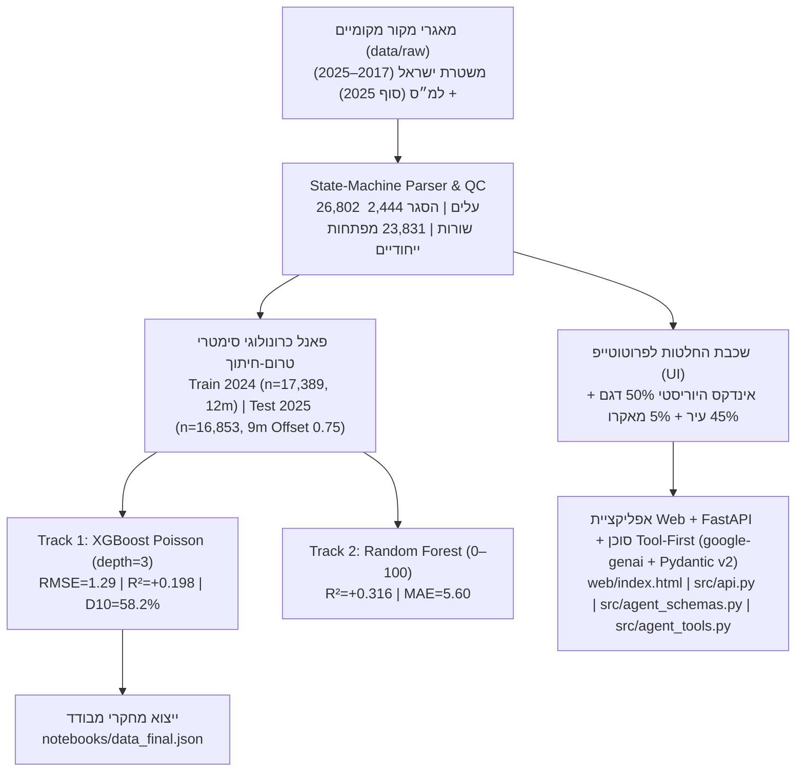

# מערכת לחיזוי ואפיון סיכוני גניבות רכב בישראל (CarTheftRisk 2017–2025)

[](https://www.python.org/)
[-16a34a)](notebooks/CarTheftRisk_final.ipynb)
[](src/api.py)
[](tests/)

מערכת הנדסית ומחקרית לדירוג סיכון כמותי יחסי של גניבות רכב בישראל ברזולוציית **יצרן × דגם × שנתון × רשות מקומית**, המבוססת על מאגרי משטרת ישראל ומצבת כלי הרכב הרשמית של הלמ"ס (2017–2025). הפרויקט מפריד באופן חד בין **שכבת חיזוי אמפירית נקייה מזליגה (ML)** לבין **שכבת תמיכה בהחלטות וסימולציית סוכן AI (Bestie Copilot)** להדגמה מוצרית.

> מקור האמת המלא של הפרויקט (כל המספרים, פרוטוקול החשיפה וטבלאות הבנצ'מארק) מתועד ב-[SINGLE_SOURCE_OF_TRUTH.md](SINGLE_SOURCE_OF_TRUTH.md).

---

## עיקרי הממצאים והמתודולוגיה (`CarTheftRisk_final.ipynb`)

- **אפס נתונים סינתטיים ובקרת מכונת מצבים:** אלגוריתם `State-Machine Parser` עם איפוס היררכי קשיח (`vt -> yr -> mk -> md`) מחלץ **`26,802` שורות עלה** (`54,007` גניבות בשנים 2023–2025; `105,711` גניבות רב-שנתיות בדגמים ב-2017–2025), מבודד `2,444` שורות חסרות שנתון/יישוב להסגר מתועד, ובונה **`23,831` מפתחות פאנל מוניציפליים ייחודיים** על פני `1,271` צמדי יצרן-דגם ו-`1,205` רשויות מקומיות.
- **פאנל כרונולוגי ללא בחירת אוכלוסייה מהעתיד + `Exposure Offset`:** אוכלוסיית האימון (`2024`, $n=17,389$, 12 חודשים) ואוכלוסיית המבחן העיוור (`2025`, $n=16,853$, 9 חודשים) נבנות אך ורק ממידע שנצפה עד סוף $T-1$. פערי אורך התקופה ב-2025 מכוילים מתמטית באמצעות `Poisson Exposure Offset = log(0.75)`.
- **ביצועי מודל הספירה במבחן עיוור על 2025 (Track 1):**
  - כוונון היפר-פרמטרים מרחבי (`5-Fold GroupKFold` לפי עיר על שנת 2024 בלבד) בחר את **`XGBoost Poisson (max_depth=3)`**.
  - על שנת המבחן העיוורת 2025 השיג המודל **`MAE = 0.4776`**, **`RMSE = 1.2898`**, **`R² = +0.1984`**, **`Poisson Deviance = 0.9690`** וצמצום של **`41.1%` בשגיאת הזנב** במוקדים כבדים (`Tail MAE = 8.67` לעומת `14.73` בבייסליין החציון, ושיפור של **`33.0%`** ב-`MAE` לעומת מודל ההתמדה המכויל).
  - **כושר הפרדה בעשירונים משמרי-תיקו (`Cluster Bootstrap`):** מונוטוניות מלאה מעשירון 1 ועד 10, מתאם דירוג ספירמן **`ρ = 0.4089`** (`95% CI: [0.3386, 0.4561]`), ועשירון עליון (`D10`) הלוכד **`58.18%` מכלל גניבות הרכב** (`95% CI: [47.68%, 63.42%]`, מכפיל `Lift` של פי `109.4x` מול עשירון 1).
- **מסלול ציון העצימות הרציף (Track 2, 0–100 מנורמל לתקרת אימון 2024 בלבד):** `Random Forest Regressor` משיג **`R² = +0.3157`** ו-**`MAE = 5.60`** נקודות.
- **ניתוח מצבת כלי הרכב של הלמ"ס לסוף 2025 (נספח D):**
  - מתוך `4,348,275` כלי רכב מנועיים פעילים (`4.68‰`), מצבת הרכבים הפרטיים עומדת על **`3,789,429`** כלים עם שיעור גניבה ארצי נצפה של **`3.51` ל-1,000 רכבים פרטיים** (`9,974` גניבות ב-9 חודשים / `13,299` בקצב שנתי).
  - חשיפת הטרוגניות חדה במותגי רכב חשמלי טהור (מכנה רשמי מתרשים 10 של הלמ"ס): `אורה` (`27.47‰`) ו`ג'ילי` (`19.51‰`) לעומת `בי-ווי-די` (`1.53‰`) ו`טסלה` (`0.16‰`).
  - במדד החשיפה הפרוקסי הדטרמיניסטי לדגמים פרטיים מרכזיים (`0.3 + 0.7 * model_internal_weight`), מובילות `טויוטה קורולה` (`37.00‰`), `טויוטה יאריס` (`36.80‰`) ו`יונדאי אלנטרה` (`22.17‰`).

---

## ארכיטקטורת המערכת



---

## מבנה הפרויקט

```text
stolen-vehicles-project/
├── SINGLE_SOURCE_OF_TRUTH.md                    # מקור האמת הרשמי של כל מדדי המחקר והריצה
├── README.md                                    # סקירת הפרויקט והוראות הרצה
├── ARCHIVE_STATUS.md                            # תיעוד הקבצים הפעילים מול תיקיית הארכיון
├── GEMINI.md                                    # הנחיות וכללי קרקע לסביבת הפיתוח וה-AI
├── design.md                                    # מערכת העיצוב והטוקנים של הממשק והדוחות
├── render.yaml                                  # הגדרות פריסה ל-Render
├── pytest.ini                                   # הגדרות הרצת בדיקות אוטומטיות
├── requirements.txt                             # תלויות Python מלאות (מחקר + פיתוח)
├── requirements-prod.txt                        # תלויות ריצה קלות לפרודקשן
│
├── data/
│   └── raw/                                     # קובצי משטרת ישראל והלמ״ס (כולל מצבת 2025)
│
├── notebooks/
│   ├── CarTheftRisk_final.ipynb                 # מחברת המחקר והריצה הקנונית (58 תאים, 0 שגיאות)
│   ├── data_final.json                          # ייצוא JSON מתוך CarTheftRisk_final
│   └── ARCHIVE_STATUS.md                        # סטטוס מחברות פעילות ומאורכבות
│
├── models/                                      # ארטיפקטים שמורים לחוזה הריצה וה-API
│   ├── xgb_theft_regressor.json
│   ├── model_card.json
│   ├── model_registry.json
│   └── temporal_backtest_final.json
│
├── src/                                         # קוד צד-שרת, ולידציה וסוכן AI
│   ├── api.py                                   # שרת FastAPI (/health, /predict, /agent/*)
│   ├── agent.py                                 # תזמור סוכן Tool-First היברידי מעל google-genai + 4 שכבות Guardrails
│   ├── agent_schemas.py                         # סכמות Pydantic v2 קשיחות (QueryPlan, Guardrails)
│   ├── agent_tools.py                           # 5 כלי Python דטרמיניסטיים לסימולציית Bestie
│   └── temporal_validation.py                   # בקרת אי-זליגה וולידציה טמפורלית לחוזה הריצה
│
├── web/                                         # ממשק המשתמש והדוחות ההנדסיים
│   ├── index.html                               # סימולטור הסיכון וסוכן ה-AI האינטראקטיבי
│   ├── final.html                               # דוח הפרויקט המסכם (מסונכרן ל-CarTheftRisk_final)
│   ├── agent_report.html                        # דוח ארכיטקטורת סוכן ה-AI (Bestie Copilot)
│   ├── stolen_vehicles_web_engineering_guide_v5.html # מדריך הנדסי ומחקרי מקיף (מהדורה 5)
│   └── assets/                                  # קובצי data.json, final_scores.json וגרפים
│
├── docs/                                        # תוכנית פרויקט (CAPSTONE_PROJECT_PLAN) ומגבלות המחקר (RESEARCH_LIMITATIONS)
├── tests/                                       # 32 בדיקות אינטגרציה, חוזה ריצה וסוכן (pytest)
└── archive/                                     # ארכיון מסודר של גרסאות קודמות וקובצי טיוטה
```

---

## התקנה והרצה מקומית

### 1. התקנת סביבת העבודה
```powershell
cd stolen-vehicles-project
pip install -r requirements.txt
```

### 2. הרצת חבילת הבדיקות האוטומטית (32 בדיקות)
בסביבת Windows מומלץ להריץ עם דגל UTF-8:
```powershell
python -X utf8 -m pytest -v
```

### 3. הפעלת שרת ה-API והסוכן (FastAPI)
```powershell
python -X utf8 -m uvicorn src.api:app --reload --port 8000
```
- בדיקת תקינות: `http://127.0.0.1:8000/health`
- תיעוד Swagger אינטראקטיבי: `http://127.0.0.1:8000/docs`

### 4. פתיחת ממשק ה-Web ודוח הפרויקט
אפשר לפתוח את `web/index.html` ואת `web/final.html` ישירות בדפדפן (בזכות `embedded_data.js`), או להגיש אותם דרך שרת מקומי:
```powershell
python -X utf8 -m http.server 8080 --directory web
```
- סימולטור הסיכון וסוכן ה-AI: `http://127.0.0.1:8080/index.html`
- דוח הפרויקט המסכם: `http://127.0.0.1:8080/final.html`
- דוח סוכן ה-AI: `http://127.0.0.1:8080/agent_report.html`

---

## גבולות גזרה מתודולוגיים ואתיים

1. **דירוג יחסי קבוצתי ולא חיזוי לרכב בודד:** המודל מעריך את קצב הגניבות הצפוי לתא `דגם × שנתון × עיר` ואינו חוזה אם רכב פרטי מסוים ייגנב.
2. **הפרדה בין חיזוי ML לציון UI ומחירי ביטוח:** נוסחת ה-UI (`50/45/5`) היא אינדקס היוריסטי להדגמה מוצרית, והצעות המחיר של סוכן `Bestie` הן סימולציה מחקרית דטרמיניסטית ולא הצעות מחיר חיות של מבטח מורשה (ראו [docs/RESEARCH_LIMITATIONS.md](docs/RESEARCH_LIMITATIONS.md)).
3. **הוגנות אלגוריתמית:** מאפיינים דמוגרפיים/אתניים הוסרו לחלוטין ממטריצת האימון ומהמערכת.
