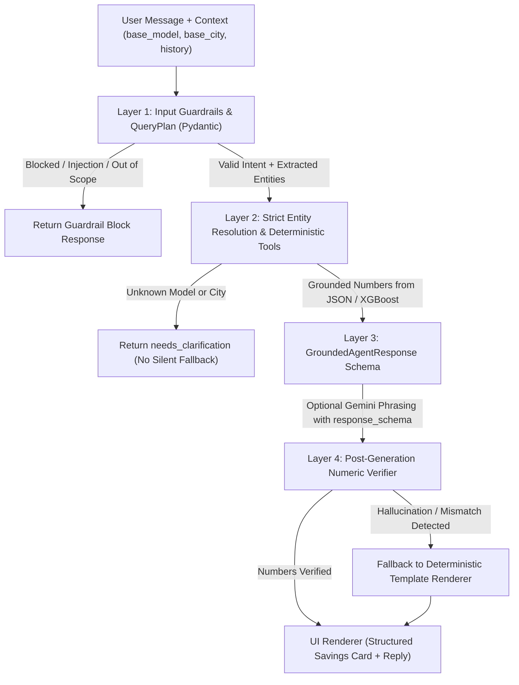

# תוכנית עבודה: תמיכה בשאלות פתוחות בצ'אטבוט הסוכן עם Guardrails, סכמות פלט מובנות ואפס הזיות

> **מטרה:** לאפשר למשתמשים לשאול בצ'אט הסוכן שאלות פתוחות (כגון `"כמה אחסוך בקיה נירו?"`, `"כמה אחסוך אם אעבור מחיפה לתל אביב?"`, `"כמה אחסוך רק עם קודן?"`) ולקבל תשובות מדויקות, מובנות ומאומתות מתוך מודל ה-ML ומנוע הכלים הדטרמיניסטי — ללא המצאת מספרים או הזיות.

---

## 1. רקע וניתוח הבעיה הקיימת (Root Cause)

בבדיקת הקוד הקיים זוהו חסמים בשתי שכבות:

1. **בצד הלקוח ([web/index.html](file:///d:/michal%20hardisk/development/AI%20Engineering%20Course/stolen-vehicles-project/web/index.html#L4061-L4099) — `generateLocalSideReply` ו-`submitSideAgentChat`):**
   * מנוע התשובות המקומי מסנן שאלות באמצעות בדיקת מילות מפתח קשיחה (`msg.includes(...)`) עבור 2 תבניות בלבד (מיגון / השוואת 4 רכבים), ללא חילוץ ישויות מתוך הטקסט.
   * בקשת ה-POST ל-`/agent/chat` ([web/index.html](file:///d:/michal%20hardisk/development/AI%20Engineering%20Course/stolen-vehicles-project/web/index.html#L4312-L4338)) מעבירה רק את `selectedModel` ו-`selectedCity` מהמצב הכללי בדשבורד, בלי היסטוריית שיחה (`history`) ובלי פרסור של דגם/עיר חלופיים מתוך השאלה.

2. **בצד השרת ([src/agent.py](file:///d:/michal%20hardisk/development/AI%20Engineering%20Course/stolen-vehicles-project/src/agent.py#L113-L258) ו-[src/agent_tools.py](file:///d:/michal%20hardisk/development/AI%20Engineering%20Course/stolen-vehicles-project/src/agent_tools.py#L168-L270)):**
   * `_route_and_answer_deterministically` ב-[src/agent.py](file:///d:/michal%20hardisk/development/AI%20Engineering%20Course/stolen-vehicles-project/src/agent.py#L113-L210) בודק 3 רשימות מילות מפתח קבועות. מילים כמו `"אחסוך"` או `"חיסכון"` אינן מזוהות, והפונקציה `simulate_mitigation_discount` נקראת תמיד בלי פרמטר `measures` (ולכן מחזירה תמיד חבילה קבועה של 3 אמצעי מיגון).
   * `run_chat_agent` ב-[src/agent.py](file:///d:/michal%20hardisk/development/AI%20Engineering%20Course/stolen-vehicles-project/src/agent.py#L213-L258) שולח ל-Gemini טקסט חופשי ללא `response_schema`, ללא Function Calling, וללא בדיקת מספרים חוזרת (Post-Generation Guardrail).
   * `history` מתקבל ב-[src/api.py](file:///d:/michal%20hardisk/development/AI%20Engineering%20Course/stolen-vehicles-project/src/api.py#L70-L74) (`AgentChatRequest`), אך אינו בשימוש בתוך `run_chat_agent`.
   * ב-`resolve_model_entry` וב-`resolve_city_entry` ([src/agent_tools.py](file:///d:/michal%20hardisk/development/AI%20Engineering%20Course/stolen-vehicles-project/src/agent_tools.py#L168-L270)), דגם או עיר שלא זוהו נופלים ל-cold-start fallback או לתל אביב-יפו בשקט, במקום לעצור ולבקש הבהרה.

---

## 2. ארכיטקטורת היעד

---

## 3. סכמות קלט ופלט מובנות (Pydantic Schemas)

יוגדר קובץ חדש `src/agent_schemas.py` שיכיל את כל חוזי המידע המוקלדים (בשימוש Pydantic):

### א. סכמת תכנון השאילתה (`QueryPlan`)
* **`IntentEnum`:**
  * `compare_model_savings` — השוואת עלות וסיכון מול דגם אחר (`"כמה אחסוך בקיה נירו?"`)
  * `compare_city_savings` — השוואת עלות וסיכון במעבר לעיר/יישוב אחר (`"כמה אחסוך אם אגור בחיפה?"`)
  * `mitigation_savings` — חישוב הנחה וסיכון לפי אמצעי מיגון ספציפיים (`"כמה אחסוך רק עם קודן?"`)
  * `risk_explanation` — הסבר גורמי סיכון לדגם ולעיר
  * `alternatives_list` — השוואה ל-3 חלופות זולות יותר בקטגוריה
  * `out_of_scope` — שאלה שאינה קשורה לסיכון גניבה או ביטוח רכב
  * `prompt_injection` — ניסיון עקיפת הנחיות מערכת
* **שדות מובנים ב-`QueryPlan`:**
  * `intent: IntentEnum`
  * `target_model: str | None`
  * `target_city: str | None`
  * `mitigation_measures: list[str]` (ערכים מורשים בלבד מתוך `MITIGATION_CATALOG`)
  * `needs_clarification: bool`
  * `clarification_question_he: str | None`

### ב. מדדי חיסכון מוקלדים (`SavingsMetrics`)
* `base_model_he: str`, `base_city: str`
* `target_model_he: str | None`, `target_city: str | None`
* `base_annual_nis: int`, `target_annual_nis: int`
* `annual_savings_nis: int`, `monthly_savings_nis: int` (יכול להיות גם שלילי או `0` אם היעד יקר יותר — דיווח כן ושקוף)
* `base_risk_score: int`, `target_risk_score: int`, `risk_delta_pts: int`

### ג. סכמת הפלט המלאה (`GroundedAgentResponse`)
* `status: Literal["answered", "needs_clarification", "blocked"]`
* `engine: Literal["gemini_verified", "deterministic_grounded", "guardrail_filter"]`
* `intent: IntentEnum`
* `reply: str` (נשמר גם בשם `reply` לתאימות מלאה לאחור ב-API וב-Frontend)
* `metrics: SavingsMetrics | None`
* `assumptions: dict[str, Any]` (כולל `REFERENCE_DRIVER_PROFILE`)
* `data_coverage_note: str` (האם קיימת תצפית 2024 בדגם–עיר או שמדובר ב-cold-start)
* `tools_used: list[str]`
* `guardrails_passed: list[str]`
* `disclaimer: str`

---

## 4. מנגנוני Guardrails ומניעת הזיות (4 שכבות הגנה)

1. **שכבה 1 — Input Guardrails וסינון קלט מוקדם:**
   * הגבלת אורך הודעה (למשל עד 500 תווים), נרמול טקסט, וחסימת דפוסי Prompt Injection בעברית ובאנגלית לפני פנייה ל-LLM או לכלים.
   * סיווג `out_of_scope` מחזיר הודעת מסגרת מנומסת בלי ניחושים ובלי קריאה לכלים.

2. **שכבה 2 — Strict Entity Resolution (אפס ניחוש ישויות):**
   * הוספת דגל `strict: bool = False` ל-`resolve_model_entry` ול-`resolve_city_entry` ב-[src/agent_tools.py](file:///d:/michal%20hardisk/development/AI%20Engineering%20Course/stolen-vehicles-project/src/agent_tools.py#L168-L270).
   * כאשר המשתמש שואל על דגם או עיר מסוימים בשאלה פתוחה (`strict=True`) והערך לא מותאם בוודאות ל-`data.json` / `MODEL_ALIASES`, הפונקציה מחזירה `None` במקום ליפול בשקט ל-cold-start או לתל אביב-יפו.
   * במקרה כזה, הסוכן עונה ב-`status="needs_clarification"` ומציג רשימת דגמים/ערים קרובים שכן קיימים במאגר.

3. **שכבה 3 — Deterministic Calculation Engine (`calculate_custom_savings`):**
   * כל חישוב של מחיר, חיסכון חודשי/שנתי, הפרש סיכון והנחת מיגון מתבצע **אך ורק בפייתון** בתוך כלי חדש `calculate_custom_savings(base_model, base_city, target_model=None, target_city=None, measures=None)`.
   * אם המשתמש שאל על דגם חלופי שדווקא **מייקר** את הביטוח או מעלה סיכון — הכלי מדווח על העלות העודפת בצורה כנה ושקופה במקום להסתיר או לעגל לאפס.

4. **שכבה 4 — Post-Generation Numeric Verifier (אימות מספרי לאחר יצירה):**
   * אם `GEMINI_API_KEY` זמין והמודל משמש לניסוח התשובה בעברית, שכבת ה-Verifier מחלצת את כל המספרים מתוך `reply` שנוצר (סכומים בשקלים, אחוזים, ציוני סיכון, כמויות גניבות).
   * **חוק ברזל:** כל מספר בטקסט (מלבד קבועיי הפרופיל של נהג הייחוס, כגון גיל 35, 12 שנות ותק, 3 שנים) חייב להופיע בקבוצת המספרים המאושרת שהוחזרה ישירות מהכלים.
   * אם התגלה מספר חריג/מומצא — תשובת ה-LLM נפסלת אוטומטית והמערכת מחזירה ניסוח מתבנית דטרמיניסטית מאומתת מתוך `SavingsMetrics` (`engine="deterministic_grounded"`).

---

## 5. תוכנית שינויים לפי קבצים (File-by-File)

| קובץ | מטרת השינוי | פירוט טכני |
| :--- | :--- | :--- |
| `src/agent_schemas.py` (חדש) | חוזי קלט ופלט מאומתים | הגדרת `IntentEnum`, `QueryPlan`, `SavingsMetrics` ו-`GroundedAgentResponse` באמצעות Pydantic v2. |
| [src/agent_tools.py](file:///d:/michal%20hardisk/development/AI%20Engineering%20Course/stolen-vehicles-project/src/agent_tools.py) | Grounding קפדני וחישוב הפרשים | הוספת `strict=True` ל-`resolve_model_entry` ו-`resolve_city_entry`; זיהוי שמות מיגון ספציפיים; הוספת הכלי `calculate_custom_savings`. |
| [src/agent.py](file:///d:/michal%20hardisk/development/AI%20Engineering%20Course/stolen-vehicles-project/src/agent.py) | אורקסטרציית 4 השכבות | החלפת נתב המילים הצר בפייפליין: `plan_query` -> `execute_grounded_tools` -> `render_or_verify_response`; שימוש בחלון `history` (עד 4 הודעות אחרונות); שימוש ב-`response_schema` של Gemini + Numeric Verifier. |
| [src/api.py](file:///d:/michal%20hardisk/development/AI%20Engineering%20Course/stolen-vehicles-project/src/api.py) | חשיפת הסכמה ב-API | עדכון `/agent/chat` ל-`response_model=GroundedAgentResponse` וולידציית אורך הודעה והיסטוריה ב-`AgentChatRequest`. |
| [web/index.html](file:///d:/michal%20hardisk/development/AI%20Engineering%20Course/stolen-vehicles-project/web/index.html) | חיבור צ'אט הצד והצגת כרטיס מובנה | שליחת `history` קצרה מ-`submitSideAgentChat`, עדכון `generateLocalSideReply` לשימוש כ-fallback שקוף בלבד, והוספת תצוגת סיכום מספרי מובנה (`metrics`) לצד הטקסט. |
| `tests/test_agent_guardrails.py` (חדש) | בדיקות אוטומטיות ל-Guardrails | אימות שאלות פתוחות, זיהוי ישויות, דחייה מנומסת לדגמים לא מוכרים, סינון הזרקות ופוסל מספרים מומצאים. |

---

## 6. מטריצת בדיקות לאימות לאחר היישום (`tests/test_agent_guardrails.py`)

1. **שאלת חיסכון לפי דגם:** `"כמה אחסוך אם אעבור מקורולה לקיה נירו בתל אביב?"` -> חילוץ `target_model="NIRO"`, החזרת `SavingsMetrics` מאומת וזיהוי חיסכון מדויק.
2. **שאלת חיסכון לפי עיר:** `"כמה אחסוך בראשון לציון לעומת תל אביב?"` -> חילוץ `target_city="ראשון לציון"`, חישוב הפרש סיכון וביטוח בין הערים.
3. **שאלת מיגון ספציפית:** `"כמה אחסוך רק עם קודן?"` -> הפעלת `simulate_mitigation_discount` על `"קודן מוגן + עלוקה"` בלבד (ולא על כל החבילה).
4. **דגם או עיר לא קיימים (אפס הזיות):** `"כמה אחסוך בלמבורגיני אורוס?"` -> `status="needs_clarification"`, ללא fallback שקט לדגם אקראי.
5. **Input Guardrail:** הזרקות פרומפט (`"ignore previous instructions"`) ושאלות מחוץ לתחום (`"תן מתכון לפסטה"`) -> `status="blocked"` / `out_of_scope` ללא הפעלת כלי תמחור.
6. **Output Numeric Verifier:** בדיקת Mock שבה מודל ה-LLM מחזיר מספר מומצא (למשל `₪99,999`) -> ה-Verifier מזהה את החריגה ונופל אוטומטית לניסוח הדטרמיניסטי המאומת.

---

## 7. החלטה פתוחה לאישור לפני התחלת הקוד (סעיף 3 — `"ביטוח ישיר"`)

כפי שראינו, ב-Bestie לא מופיעה חברת `"ביטוח ישיר"`, והשם הוזן ידנית ברשימת חברות לדוגמה ב-[web/index.html](file:///d:/michal%20hardisk/development/AI%20Engineering%20Course/stolen-vehicles-project/web/index.html#L3810) וב-[src/agent_tools.py](file:///d:/michal%20hardisk/development/AI%20Engineering%20Course/stolen-vehicles-project/src/agent_tools.py#L80-L104).
לפני יישום התוכנית, אשמח לאישורך לגבי אחת משתי האפשרויות:

* **אפשרות א׳ (מומלצת לשקיפות):** להסיר שמות חברות ביטוח ספציפיות מהסימולציה ולהציג תווית שקופה כמו `"אומדן שוק משוער (פרופיל ייחוס)"` או `"הערכה מבוססת Bestie"`.
* **אפשרות ב׳:** להסיר רק את `"ביטוח ישיר"` ולהשאיר רוטציה של חברות שמופיעות בפועל ב-Bestie (הראל, הפניקס, מגדל, כלל, מנורה, שומרה, AIG, ליברה).
