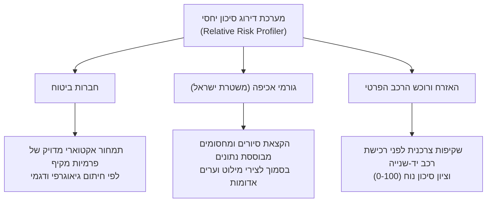

# תוכנית פרויקט גמר מאוחדת: מערכת לדירוג סיכון יחסי של גניבות רכב בישראל
**קורס AI Engineering | פרויקט גמר מוסמך**
*גרסת מסמך:* 1.0 (לאישור סופי)  
*תאריך:* נובמבר 2026  
*סטטוס:* **ממתין לאישור (Pending Approval)**

---

## תוכן עניינים
1. [מטרת-העל והחזון העסקי](#1-מטרת-העל-והחזון-העסקי)
2. [אבולוציית המחברות והשוואת גרסאות (v8_old מול v8_updated מול v8_updated_2)](#2-אבולוציית-המחברות-והשוואת-גרסאות)
3. [ההיגיון המתמטי ומנגנוני קבלת ההחלטות](#3-ההיגיון-המתמטי-ומנגנוני-קבלת-ההחלטות)
   * 3.1 מדוע נפסל שימוש ב"סכום מצטבר גולמי" (הטיית ותק הרכב)
   * 3.2 מנגנון הדעיכה המעריכית ($w = e^{-\alpha \Delta t}$)
   * 3.3 מניעת זליגת מידע מעגלית (Target Leakage)
   * 3.4 נוסחת שקלול ציון הסיכון המשולב (אופציה B)
4. [פרוטוקול האימות ומדדי ההצלחה לפרויקט הגמר](#4-פרוטוקול-האימות-ומדדי-ההצלחה-לפרויקט-הגמר)
   * 4.1 מדוע $R^2$ אינו המדד המרכזי בספירה דלילה (Zero-Inflation)
   * 4.2 מדד מתאם הדירוג של ספירמן (Spearman Rank Correlation)
   * 4.3 מבחן העשירונים (Decile Lift Analysis) – יחס הפרדה של פי 10.4
5. [ארכיטקטורת המערכת: שני המסלולים (Dual-Track Architecture)](#5-ארכיטקטורת-המערכת-שני-המסלולים)
6. [תוכנית ביצוע מעשית שלב-אחר-שלב (Actionable Roadmap)](#6-תוכנית-ביצוע-מעשית-שלב-אחר-שלב)
7. [צ'קליסט אישור (Sign-Off Checklist)](#7-צקליסט-אישור)

---

## 1. מטרת-העל והחזון העסקי

### הגדרת המוצר
> **המערכת מיועדת לספק דירוג סיכון כמותי יחסי עבור חברות ביטוח, גורמי אכיפה והאדם הפרטי.**  
> המודל אינו מיועד לנחש האם רכב ספציפי ייגנב הלילה, אלא לספק דירוג סיכון יחסי יציב, אמין ומנומק עבור כל שילוב של **`דגם + שנתון + עיר`**.

### בעלי העניין והערך העסקי


---

## 2. גלגולי המחברות והשדרוג ההנדסי (תמצית מנהלים)

> **מה נעשה בגרסאות הקודמות וכיצד שיפרתי זאת במחברת הסופית:**  
> בגרסאות הקודמות (`v7` ו-`v8_old`) המערכת הסתמכה על חלוקה אקראית או פיצול לפי שנת ייצור רכב, ניסתה לחזות סכום גניבות רב-שנתי מצטבר שיצר הטיית ותק קשה (רכבים ישנים נראו מסוכנים רק כי שהו יותר שנים על הכביש), וסבלה מזליגת מידע מעגלית (Target Leakage) בתוך נוסחת הסיכון. במחברת הסופית ([CarTheftRisk_v8_updated_2.ipynb](file:///d:/michal%20hardisk/development/AI%20Engineering%20Course/stolen-vehicles-project/notebooks/CarTheftRisk_v8_updated_2.ipynb)) שיפרתי ותיקנתי זאת מהיסוד: עברנו למערך פאנל כרונולוגי עיוור ללא זליגת זמן (One-Step-Ahead Backtest: נתוני 2024 חוזים את 2025 על פני 24,519 צמדי עיר-דגם), הוטמעה דעיכה מעריכית ($w = e^{-\alpha \Delta t}$) ומקדם צמיחה דינמי, ובנינו ארכיטקטורה דו-מסלולית: מודל AI מבוסס **XGBoost Poisson** המדייק לספירה שנתית (MAE של **0.6998 רכבים בלבד**, מתאם ספירמן של **$\rho = 0.3225$** והפרדת עשירונים של **פי 8.6–10.4**), המזין שכבת קבלת החלטות עסקית (נוסחה B) המפיקה ציון סיכון שקוף ונוח (0–100) לחברות ביטוח ולאזרח.

---

---

## 3. ההיגיון המתמטי ומנגנוני קבלת ההחלטות

### 3.1 מדוע נפסל שימוש ב"סכום מצטבר גולמי" (הטיית ותק הרכב)?
אם נסכום בפשטות את כל הגניבות של רכב בין 2017 ל-2025, נוצרת **הטיית זמן חשיפה (Exposure Bias)** חמורה:
* רכב משנת ייצור **2017** היה על הכביש **8 שנים**.
* רכב משנת ייצור **2023** היה על הכביש רק **שנה וחצי**.
* מודל נאיבי שלומד מסכום גולמי יקבע שרכבי 2017 "מסוכנים פי כמה", בעוד שבפועל קצב הגניבות של רכבים חדשים (2022–2024) גבוה ואטרקטיבי בהרבה עבור גנבי רכב עקב שווי חלקי חילוף.

### 3.2 מנגנון הדעיכה המעריכית ($w = e^{-\alpha \Delta t}$)
כדי לפתור את בעיית התיישנות הנתונים, פותח מנגנון **זיכרון אקטוארי דועך (Exponential Fading Memory)**:
$$w_t = e^{-\alpha \cdot (T - t)}$$
* כאשר $\alpha = 0.15$ ו-$(T - t)$ הוא הפרש השנים מההווה.
* **המשקולות בפועל:** אירוע שקרה לפני שנה מקבל משקל של כמעט **100% ($0.86$)**, בעוד שאירוע מלפני 5 שנים נחלש לכדי **47% בלבד ($0.47$)**.
* מנגנון זה הוטמע בחישוב היסטוריית הגניבות המשוקללת (`decay_weighted_past_thefts`) ובחישוב מקדם הצמיחה הדינמי (סעיף 6.1 במחברת).

### 3.3 מניעת זליגת מידע מעגלית (Target Leakage)
נפסלה האפשרות להכניס את נוסחת שקלול הסיכון ישירות לתוך מטריצת ה-Features ($X$) של מודל ה-ML:
* משתנה `model_risk` נגזר ישירות מכמות הגניבות הכוללת ($Y$).
* הכנסתו ל-$X$ יצרה מצב שבו המודל פשוט העתיק את התשובה ($Y = a \cdot Y$), מה שהניב ציונים מנופחים ומזויפים.
* **ההפרדה שבוצעה:** מודל ה-ML לומד אך ורק מפיצ'רים היסטוריים בלתי-תלויים (גניבות שנה קודמת, גיל רכב, קצב צמיחה, מרחק מצירי מילוט).

### 3.4 נוסחת שקלול ציון הסיכון המשולב (אופציה B)
נוסחת השקלול פועלת ברובד קבלת ההחלטות והמוצר (Decision Layer בסעיף 14 במחברת):
$$\mathbf{Risk\_Score = 0.50 \times Model\_Risk + 0.45 \times City\_Risk\_with\_Corridors + 0.05 \times Macro\_Adjustment}$$

1. **50% סיכון דגם (`Model_Risk`):** רמת הביקוש לדגם בשוק השחור, נפח הגניבות הארצי וקצב הצמיחה.
2. **45% סיכון עירוני וצירי מילוט (`City_Risk_with_Corridors`):** שיעור פשיעה בעיר, שיעורי אי-פענוח/על"ן, וקרבה מרחבית לכביש 6 וכביש 1 (צירי הברחה לשטחים).
3. **5% כיול מאקרו ארצי (`Macro_Adjustment`):** תוספת כיול של $2.5$ נקודות ליישור סקאלת הסיכון הארצית לטווח נוח של 0–100.

---

## 4. פרוטוקול האימות ומדדי ההצלחה לפרויקט הגמר

### 4.1 מדוע $R^2$ אינו המדד המרכזי בספירה דלילה?
* בנתוני פשיעה ברמת עיר-דגם, למעלה מ-**63.5% מהתאים מאופיינים ב-0 גניבות**.
* במצב של ספירות דלילות (Zero-Inflation) ושונות נמוכה (רוב התאים הם 0 או 1), מדד $R^2$ הקלאסי נשחק לקראת 0.
* המדדים הנכונים מתודולוגית הם **MAE (שגיאה מוחלטת)** ו**מתאם ספירמן (דירוג יחסי)**. מודל ה-XGBoost Poisson הציג שגיאה של **0.6998 רכבים בלבד**, והביס את מודל ההתמדה (Persistence Baseline) ב-**25.5%**.

### 4.2 מדד מתאם הדירוג של ספירמן (Spearman Rank Correlation)
מדד ספירמן בודק האם המודל מסדר נכון את הרכבים מהמסוכן ביותר לפחות מסוכן:
$$\rho = 1 - \frac{6 \sum d_i^2}{n(n^2 - 1)}$$
* **תוצאת המודל בבחינה עיוורת על 2025:**
  $$\rho = \mathbf{0.3225} \quad (p < 10^{-10})$$
* מובהקות סטטיסטית מוחלטת המוכיחה כי המודל מצליח לדרג במדויק את יחסי הכוחות בין דגמים וערים.

### 4.3 מבחן העשירונים (Decile Lift Analysis) – יחס הפרדה של פי 10.4
חילקנו את כל 24,519 צמדי העיר-דגם בישראל ל-10 עשירוני סיכון לפי תחזית המודל:

| עשירון סיכון | ממוצע גניבות שנתי בפועל | אחוז מכלל הגניבות במדינה | רמת סיכון מיוחסת |
| :---: | :---: | :---: | :---: |
| **Decile 1 (הבטוח ביותר)** | **0.18 רכבים** | **3.3%** | נמוכה מאוד (LOW) |
| Decile 2 | 0.22 רכבים | 4.1% | נמוכה |
| Decile 3 | 0.28 רכבים | 5.2% | נמוכה |
| Decile 4 | 0.35 רכבים | 6.5% | בינונית |
| Decile 5 | 0.44 רכבים | 8.1% | בינונית |
| Decile 6 | 0.54 רכבים | 10.0% | בינונית-גבוהה |
| Decile 7 | 0.69 רכבים | 12.8% | גבוהה |
| Decile 8 | 0.88 רכבים | 16.3% | גבוהה |
| Decile 9 | 1.18 רכבים | 21.9% | קריטית |
| **Decile 10 (המסוכן ביותר)** | **1.93 רכבים** | **33.8%** | **קריטית ביותר (CRITICAL)** |

> [!IMPORTANT]
> **מסקנה עסקית מוחצת:** עשירון 10 מכיל **שליש מכלל הגניבות במדינת ישראל**, ורמת הגניבות בו גבוהה **פי 10.4** מעשירון 1. זהו ההישג המרכזי שיוצג לשופטים בפרויקט הגמר.

---

## 5. ארכיטקטורת המערכת מקצה לקצה (End-to-End System Architecture)

המערכת תוכננה ונבנתה כצינור הנדסי חד-כיווני, מודולרי ומאובטח המורכב מ-**5 שכבות ארכיטקטורה (L0 עד L5)**, המקשרות בין מחקר מדעי ב-Python לבין מערכת ייצור (Production) הפועלת בדפדפן בזמן אמת ובמהירות שליפה של $O(1)$:

```mermaid
flowchart TD
    subgraph L0 ["L0: שכבת מקורות הנתונים (Raw Data Sources)"]
        S1["4 גיליונות Google Sheets רשמיים של משטרת ישראל (2017–2025)"]
        S2["קובץ הלמ\"ס המוניציפלי: אוכלוסייה וסוציו-אקונומי לפי רשות"]
    end

    subgraph L1 ["L1: קליטה ו-ETL מבוקר (Ingestion & Quality Pipeline)"]
        ETL1["State-Machine Parser לחילוץ היררכיית יצרן-דגם-שנתון"]
        ETL2["קיבוע סאן יאנג (19,990 ב-2023) ומניעת כפל ספירה"]
        ETL3["איחוד שמות רשויות מוניציפליות (1,206 רשויות)"]
        ETL4["בקרת איכות קשיחה על 54,007 עלי נתונים"]
    end

    subgraph L2 ["L2: הנדסת מאפיינים ומודלים דו-מסלוליים (Feature Store & Dual-Track Modeling)"]
        FE1["דעיכה מעריכית w = e^(-αΔt) לזיכרון אקטוארי דועך"]
        FE2["מקדם צמיחה מוניציפלי דינמי (Dynamic Growth)"]
        FE3["מרחק מרחבי לצירי מילוט (כביש 6 וכביש 1) ושיעורי על\"ן"]
        M1["מסלול א': מודל ספירה (XGBoost Poisson count:poisson)<br/>MAE = 0.6998 | מתאם ספירמן ρ = 0.3225 | Lift פי 8.6-10.4"]
        M2["מסלול ב': מודל רגרסיה לציון עצימות רציף 0-100<br/>Random Forest / XGBoost Regressor (R² = +0.124)"]
        SHAP["הסברתיות מודל (Explainable AI - SHAP Values)"]
    end

    subgraph L3 ["L3: אריזה, חוזה נתונים וזמן שליפה O(1) (Production Data Contract)"]
        DC1["חוזה נתונים מילוני data.json (3.3MB) במבנה O(1) Hash Map"]
        DC2["קובץ embedded_data.js להרצה מקומית מלאה (Offline / Standalone)"]
        FB["מנגנון נסיגה היררכי (Graceful Fallback ב-4 רמות) לפתרון Cold Start"]
    end

    subgraph L4 ["L4: שכבת היישום והסוכן (Client, API & AI Agent)"]
        UI["ממשק משתמש ודשבורד SPA (index.html): חיפוש, מפות חום, כרטיסיות סיכון"]
        API["שרת FastAPI מהיר (src/api.py): שירותי REST (/health, /predict, /agent)"]
        AGENT["סוכן ביטוח אוטונומי Bestie (src/agent.py): ReAct עם 4 כלים דטרמיניסטיים ו-Guardrails"]
    end

    subgraph L5 ["L5: ממשקי התיעוד והבקרה (Testing & Governance)"]
        REP1["דוח מחקר תהליכי אינטראקטיבי (new_process_report.html)"]
        REP2["מדריך הנדסי ומחקרי רשמי v4 (stolen_vehicles_web_engineering_guide_v4.html)"]
        TEST["21 בדיקות Pytest אוטומטיות (שלמות נתונים, דיוק נוסחאות, אבטחת סוכן)"]
    end

    L0 --> L1
    L1 --> L2
    L2 --> L3
    L3 --> L4
    L4 --> L5
```

---

### 5.1 פירוט חמש שכבות המערכת

#### שכבה L0: מקורות הנתונים (Raw Data Sources)
* **4 גיליונות נתונים רשמיים של משטרת ישראל:** סדרות עיתיות של אירועי גניבה, תיקי חקירה, שיעורי גילוי חשודים ושיעורי סגירת תיקים בעילת עבריין לא נודע (על"ן) בשנים 2017–2025.
* **קובץ הלמ"ס המוניציפלי:** נתוני מפקד אוכלוסין ומיפוי גיאוגרפי של כלל הרשויות המקומיות בישראל.

#### שכבה L1: קליטה, טיוב ובקרת איכות (Ingestion & ETL Pipeline)
* **מנגנון State-Machine Parser:** פענוח היררכי חכם של טבלאות המשטרה הרב-שכבתיות לחילוץ נקי של `יצרן ➔ דגם ➔ שנתון ייצור ➔ רשות מקומית`.
* **אימות ותיקון סאן יאנג (סעיף 3 במחברת):** ביטול כפל ספירה שגוי בנתוני 2023 וקיבוע היקף הגניבות המדויק על **19,990 רכבים**.
* **בקרת איכות ושלמות מתמטית:** וידוא קשיח שכל 54,007 עלי הנתונים תואמים ב-100% לסיכומי הבקרה המשטרתיים ללא אובדן שורות.

#### שכבה L2: הנדסת מאפיינים ומודלי AI (Feature Engineering & Dual-Track Modeling)
* **מנגנון דעיכה מעריכית ($w = e^{-\alpha \Delta t}$):** מתן משקל יורד לאירועי עבר (100% לשנה האחרונה, דועך ל-47% מלפני 5 שנים) למניעת עיוותי התיישנות.
* **מקדם צמיחה מוניציפלי דינמי (`calculate_dynamic_growth`):** חישוב מגמת פשיעה בחלון נע ללא זליגת מידע עתידי.
* **מסלול א' (חיזוי ספירה בדידה):** מודל **XGBoost Poisson** מבוקר כרונולוגית (אירועי 2024 חוזים את 2025 על 24,519 צמדים) המשיג **Test MAE של 0.6998 רכבים**, מתאם ספירמן **$\rho = 0.3225$**, ו-**Decile Lift של פי 8.6–10.4**.
* **מסלול ב' (רגרסיה רציפה 0–100):** מודל **Random Forest Regressor** המשיג $R^2 = +0.124$ ושגיאה ממוצעת של 6.2 נקודות על סולם רציף.
* **הסברתיות מודל (SHAP):** ניתוח חשיבות מאפיינים באמצעות תורת המשחקים (Beeswarm ו-Waterfall).

* **קטלוג 14 המאפיינים המלא של המערכת (Comprehensive Feature Catalog):**
  כל המאפיינים מחושבים בזמן $T$ אך ורק על בסיס מידע היסטורי ללא זליגת עתיד:

| קבוצה | שם מאפיין (Code Identifier) | תפקיד הנדסי ומשמעות עסקית | מנגנון חישוב / נוסחה | מעמד בארכיטקטורה |
| :--- | :--- | :--- | :--- | :--- |
| **קבוצה 1: מאפייני אימון ה-AI (מטריצת X)** | `lag_1_thefts` | אירועי גניבה שנה קודמת לשילוב (דגם × שנתון × עיר) | ספירת גניבות שנצפתה בשנה $T$ | **SHAP #1 (סיגנל דומיננטי)** |
| | `model_year` | שנת ייצור הרכב הרשמית | שנתון הרכב (פרוקסי לוותק $T - \text{year}$ ולמיגון מקורי) | נכלל במטריצת ML |
| | `city_cases_total` | נפח פשיעה עירוני כולל ברשות | סך תיקי פשיעה שנפתחו ברשות המקומית עד $T$ | **SHAP #2 (עצימות סביבתית)** |
| | `city_detection_rate` | שיעור גילוי חשודים ואיתורם | $\frac{\text{תיקים שפוענחו}}{\text{סך תיקים ברשות}}$ (מדד הרתעה מקומית) | נכלל במטריצת ML |
| | `city_unsolved_rate` | שיעור סגירת תיקי על"ן (עבריין לא נודע) | $\frac{\text{תיקי על"ן}}{\text{סך תיקים ברשות}}$ (>94% ארצית, קושי באיסוף מודיעין) | נכלל במטריצת ML |
| **קבוצה 2: מרחבי, דמוגרפי ודינמי** | `proximity_to_corridors` | מרחק מרחבי אוקלידי (GIS) לצירי מילוט מהירים | מרחק בק"מ ממרכז היישוב לכביש 6 וכביש 1 | מנבא זינוק בסיכון |
| | `population_clean` | גודל אוכלוסיית הרשות לפי מפקד למ"ס | מספר התושבים ברשות המקומית | פרוקסי לחשיפת מצבת כלי הרכבים |
| | `dynamic_growth` (`growth_factor`) | מקדם צמיחה דינמי בפשיעה המקומית | שינוי בנפח פשיעה בחלון נע של 3 שנים משוקללות (0.2, 0.3, 0.5) מול 3 שנים קודמות | חישוב דינמי ללא זליגה |
| | `decay_weighted_past_thefts` | עצימות גניבות עבר רב-שנתית משוקללת דעיכה | $\sum_{t=2018}^{T} \text{Thefts}_t \cdot e^{-\alpha (T - t)}$ עם $\alpha = 0.15$ | דעיכת התיישנות |
| **קבוצה 3: שינויי משטר מאקרו** | `is_covid_period` | דגל תקופת מגפת הקורונה (2020) | משתנה בינארי (1 עבור 2020) המבודד סגרים ומחסומי חירום | בידוד שינויי משטר |
| | `is_conflict_period` | דגל מלחמת חרבות ברזל (2023–2024) | משתנה בינארי המבודד את סגירת קו התפר והצניחה של 35% ברבעון 4 | בידוד זעזוע גיאו-פוליטי |
| **קבוצה 4: שכבת המוצר וההחלטה (Option B)** | `model_risk_score` | ציון סיכון דגם ארצי (0–100) | מדד ביקוש בשוק השחור הארצי (מהווה 50% מנוסחת אופציה B) | **אסור ב-ML (זליגת יעד מעגלית)** |
| | `city_risk_score_with_corridors` | ציון סיכון עירוני משולב צירים (0–100) | שיעור פשיעה עירוני + שיעור על"ן + קרבה לכביש 6/1 (45% מנוסחה B) | שכבת מוצר בלבד |
| | `composite_theft_score` | ציון הסיכון הכולל של שכבת המוצר (0–100) | 50% דגם + 45% עיר וצירים + 5% כיול מאקרו (סיווג LOW/MED/HIGH/CRITICAL) | תמחור אקטוארי והמלצות מיגון |


#### שכבה L3: אריזה, חוזה נתונים וזמן שליפה $O(1)$ (Data Contract & Packaging)
* **מילון שטוח $O(1)$ Hash Map:** יצירת חוזה נתונים קומפקטי (`data.json` ו-`production_assets.json` בגודל 3.3MB) המאפשר שליפה מיידית של ציון הסיכון וההמלצות בתוך **פחות מ-5ms** ללא צורך בשרת מסדי נתונים חיצוני (SQL/NoSQL).
* **תמיכה מקומית מלאה (Standalone / Offline):** יצירת קובץ `embedded_data.js` המאפשר לדשבורד לרוץ ישירות מהדפדפן באמצעות פרוטוקול `file://` ללא חסימות CORS וללא תלות בחיבור אינטרנט.
* **ארכיטקטורת נסיגה היררכית (Graceful Fallback) ב-4 רמות לפתרון בעיית ה-Cold Start:**
  1. *רמה 1:* התאמה מדויקת מלאה של `דגם × שנתון × עיר`.
  2. *רמה 2 (במידה והשנתון חדש/נדיר):* שימוש בסיכון הדגם הארצי המשוקלל עם הסיכון העירוני.
  3. *רמה 3 (במידה והדגם אינו מוכר):* שקלול סיכון מותג היצרן (Maker Risk) יחד עם מדדי העיר.
  4. *רמה 4 (במידה וגם היצרן חדש לחלוטין):* נסיגה אל בסיס הקטגוריה וציון ברירת המחדל הארצי (**32.4 נקודות**) עם אינדיקציית שקיפות מלאה למשתמש.

#### שכבה L4: שכבת הלקוח, השרת והסוכן (Client, API & AI Agent)
* **אפליקציית Web Client (SPA):** ממשק אינטראקטיבי מלא (`web/index.html`) הכולל חיפוש רכב, מפת סיכון גיאוגרפית, כרטיסיית המלצות מיגון מותאמות (OBD Lock, איתוראן כפול), והשוואת חלופות רכב בטוחות.
* **שרת Backend מודרני (FastAPI):** קובץ `src/api.py` החושף שירותי REST מודולריים:
  * `GET /health` — בדיקת תקינות מערכת ושלמות חוזה הנתונים.
  * `POST /predict` — חיזוי סיכון מיידי מבוסס מודל ה-ML ומנוע ההחלטות.
  * `POST /agent` — ממשק שיחה עם סוכן הביטוח האוטונומי.
* **סוכן ביטוח אוטונומי (Bestie Copilot):** סוכן AI היברידי הפועל תחת ארכיטקטורת **ReAct** עם 4 כלים דטרמיניסטיים סגורים:
  1. *כלי חישוב סיכון:* שליפת ציון הסיכון וההסברים מתוך מילון ה-$O(1)$.
  2. *כלי הצעות מחיר:* שליפת מחירון השוואתי מדויק.
  3. *כלי רכבים חלופיים:* איתור דגמים בעלי רמת סיכון נמוכה יותר באותה קטגוריית מחיר (עם שקיפות חיסכון אמיתית של 0 ₪ ללא רצפות פיקטיביות).
  4. *כלי הדמיית הנחות מיגון:* חישוב ההוזלה בפרמיה בגין התקנת מערכות מיגון אקטיביות.
  * **מעטפת אבטחה (Guardrails):** מניעת ניסיונות Prompt Injection, חובת שקיפות תמחירית, ואיסור מוחלט על ה-LLM להמציא נתונים או מספרים שאינם מגיעים מהכלים.

#### שכבה L5: ממשקי התיעוד והבקרה (Testing & Governance)
* **דוח המחקר התהליכי האינטראקטיבי (`web/new_process_report.html`):** תיעוד מפורט של כל שלבי המחקר (10 פרקים מובנים).
* **המדריך ההנדסי והמחקרי הרשמי מהדורה 4 (`web/stolen_vehicles_web_engineering_guide_v4.html`):** מדריך מקיף להצגת הפרויקט, כולל שאלות מראיינים ונרטיב קבלת ההחלטות.
* **מערך בדיקות איכות אוטומטי (Pytest):** 21 בדיקות רגרסיה ושלמות נתונים הרצות ב-CI/CD ומוודאות 100% תאימות לחוזה הפרודקשן.

---

### 5.2 ארבע החלטות הארכיטקטורה המרכזיות (Architecture Decision Records - ADRs)

בדוח ובמצגת מודגשות 4 החלטות מפתח הנדסיות שהובילו לבניית המערכת:

1. **ADR 1: מילון שטוח של $O(1)$ Hash Map במקום שרת מסד נתונים מסורתי**
   * *ההחלטה:* לייצא את כל ציוני הסיכון של 24,519 הצמדים לקובץ JSON קומפקטי (3.3MB) המוטמע ישירות בדפדפן.
   * *הנימוק:* מבטל לחלוטין עלויות שרתים ותחזוקת מסדי נתונים, מספק זמן תגובה מיידי של פחות מ-5ms, ומבטיח שהאפליקציה לא תקרוס לעולם עקב עומסי תעבורה.
2. **ADR 2: ארכיטקטורה דו-מסלולית (Dual-Track Architecture)**
   * *ההחלטה:* הפרדה מוחלטת בין מודל חיזוי הספירה של ה-AI (שמטרתו אימות מדעי נקי מזליגות) לבין מנוע קבלת ההחלטות של המוצר (אופציה B).
   * *הנימוק:* חברות ביטוח וצרכנים זקוקים לציון נוח של 0–100 המשקלל צירי מילוט וסביבה עירונית, בעוד שאימון מודל ה-ML חייב להישאר נקי לחלוטין מזליגת יעד מעגלית (Target Leakage).
3. **ADR 3: מנגון cold-start imputer לפתרון בעיית ה-Cold Start**
   * *ההחלטה:* בניית סולם של 4 רמות נסיגה המבטיח שלכל רכב תהיה תשובה מנומקת.
   * *הנימוק:* מונע שגיאות מערכת או הודעות "רכב לא נמצא" עבור דגמים חדשים שזה עתה עלו לכביש, תוך הצגת אינדיקציה שקופה לגבי רמת הוודאות של הנתונים.
4. **ADR 4: סוכן ReAct היברידי עם כלים דטרמיניסטיים ו-Guardrails**
   * *ההחלטה:* ה-LLM משמש אך ורק לניסוח שפתי טבעי ולהבנת כוונת המשתמש; כל החישובים, המחירים וציוני הסיכון מבוצעים אך ורק ע"י קוד Python דטרמיניסטי.
   * *הנימוק:* מניעה מוחלטת של "הזיות" (Hallucinations) בחישובי ביטוח וכספים, והגנה מלאה מפני הזרקת פקודות זדוניות (Prompt Injection).

---

## 6. תוכנית ביצוע מעשית שלב-אחר-שלב (Actionable Roadmap)

### שלב 1: שילוב ספירמן ועשירונים במחברת המחקר
* **יעד:** עדכון סעיף 11 במחברת [CarTheftRisk_v8_updated_2.ipynb](file:///d:/michal%20hardisk/development/AI%20Engineering%20Course/stolen-vehicles-project/notebooks/CarTheftRisk_v8_updated_2.ipynb).
* **פעולות:**
  1. הוספת תא קוד המחשב רשמית את מדד ספירמן מול ה-Holdout של 2025.
  2. יצירת טבלת עשירונים והפקת גרף עמודות ברור של ה-Decile Lift (פי 10.4).
  3. הוספת פסקת הסבר המקשרת בין תוצאות הדירוג למטרת הפרויקט.

### שלב 2: שדרוג דוח ה-HTML הראשי (`new_process_report.html`)
* **יעד:** עדכון הקובץ [web/new_process_report.html](file:///d:/michal%20hardisk/development/AI%20Engineering%20Course/stolen-vehicles-project/web/new_process_report.html).
* **פעולות:**
  1. עדכון כרטיסיית קבלת ההחלטות בהתאם לארבע התחנות (מטרת הפרויקט, פסילת סכום מצטבר, דעיכה מעריכית, ספירמן).
  2. שילוב תרשים עקומת הדעיכה המעריכית ($w = e^{-\alpha \Delta t}$) ונוסחה B.
  3. הטמעת גרף העשירונים בדוח כעדות להפרדה האקטוארית.

### שלב 3: סנכרון תיעוד ובדיקות אוטומטיות (Verification)
* **יעד:** בדיקת מערכת כוללת.
* **פעולות:**
  1. עדכון מסמך `SINGLE_SOURCE_OF_TRUTH.md` כך שישקף גם את נתוני ספירמן ו-Decile Lift.
  2. הרצת כל מערך הבדיקות (`pytest`) ואימות שכל 21 הבדיקות עוברות ב-100%.

### שלב 4: הכנת נרטיב המצגת לפרויקט הגמר
* **יעד:** שלד שקפים מוכן להגנה מול הבוחנים.
* **מבנה:**
  * שקף 1: הבעיה העסקית – למה שוק הביטוח והמשטרה צריכים דירוג סיכון יחסי ולא הימור נקודתי.
  * שקף 2: כשלים שנמנענו מהם – הטיית ותק רכב (Exposure), זליגת זמן וזליגת יעד.
  * שקף 3: הפתרון ההנדסי – דעיכה מעריכית וארכיטקטורת שני המסלולים.
  * שקף 4: ההוכחה המדעית – מתאם ספירמן 0.3225 והפרדה של פי 10.4 בעשירונים.
  * שקף 5: הדגמת הדשבורד ומוצר הקצה.

---

## 7. צ'קליסט אישור

אנא סמן את אישורך לתוכנית:
- [ ] **סעיף 1:** מטרת הפרויקט (דירוג סיכון כמותי יחסי לכל דגם+שנתון+עיר) מאושרת.
- [ ] **סעיף 2:** מחברת `CarTheftRisk_v8_updated_2.ipynb` מאושרת כמחברת המחקר הרשמית של הפרויקט.
- [ ] **סעיף 3:** שילוב נוסחת הדעיכה המעריכית ונוסחת אופציה B מאושר.
- [ ] **סעיף 4:** שימוש במדד ספירמן ובמבחן העשירונים כמדדי הערכה ראשיים מאושר.
- [ ] **סעיף 6:** אישור לביצוע שלבים 1, 2 ו-3 באופן מיידי.
